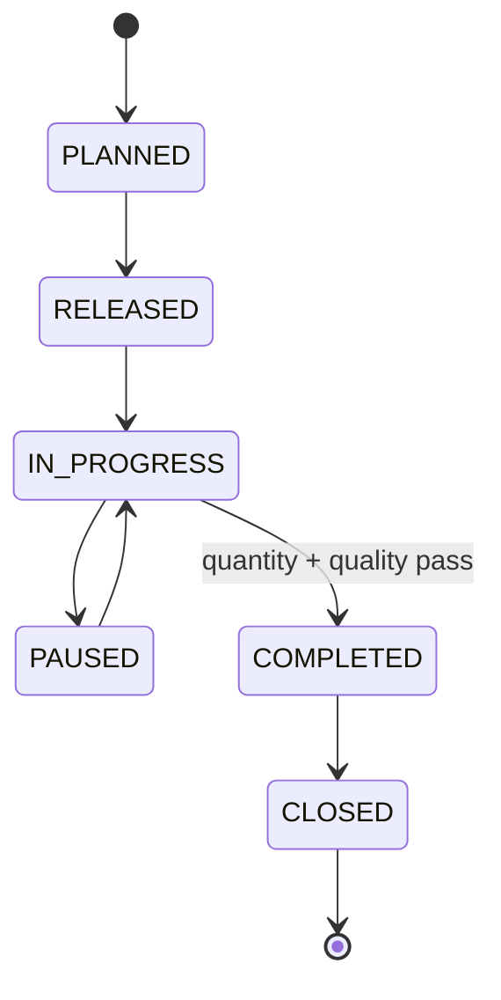
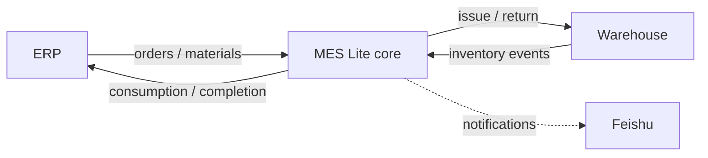

<div align="center">

# MES Lite Integration Kit

**A small, synthetic MES workflow core with ERP, warehouse and Feishu integration contracts.**

[](https://github.com/changhaoting1998-star/mes-lite-integration-kit/actions/workflows/ci.yml)
[](https://nodejs.org/)
[](docs/openapi.yaml)
[](LICENSE)
[](docs/PRIVACY.md)

[Quick start](#quick-start) · [Production flow](#production-flow) · [Integration contracts](#integration-contracts) · [中文说明](#中文说明)

</div>

MES Lite Integration Kit is a readable starting point for teams learning MES concepts or prototyping integrations. It models production-order transitions, operation reporting, quality gates, idempotent synchronization and neutral contracts for ERP, warehouse and Feishu collaboration.

The repository is a clean-room implementation built from generic manufacturing patterns. Every product, order, material, operation and role is fictional; no real formula, customer, supplier, capacity, cost, device, shift or credential is present.

## Why this project

- **Learn the core before adopting a large platform.** The rules fit in a small JavaScript package.
- **Integrate without sharing private factory data.** Contracts and examples use synthetic payloads.
- **Treat retries as a first-class problem.** Idempotency helpers prevent duplicate ERP/WMS events.
- **Keep collaboration optional.** Feishu notifications sit behind the same neutral adapter boundary.
- **Use the API contract from any language.** An OpenAPI example accompanies the JavaScript core.

## Included capabilities

| Area | Included behavior |
| --- | --- |
| Production order | Plan, release, run, pause, complete and close |
| Operation reporting | Good quantity, scrap quantity and timestamps |
| Quality | Checkpoints, results and nonconformance blocking |
| Integration safety | Idempotency keys and duplicate-event handling |
| Adapters | ERP, warehouse and Feishu notification contracts |
| API contract | OpenAPI example for cross-language implementations |

## Quick start

```bash
git clone https://github.com/changhaoting1998-star/mes-lite-integration-kit.git
cd mes-lite-integration-kit
npm install
npm run verify
```

```js
import { createOrder, transitionOrder } from "mes-lite-integration-kit";

let order = createOrder({
  id: "demo_order_001",
  productId: "demo_product_a",
  plannedQuantity: 100,
  dueAt: "2099-12-31T00:00:00.000Z"
});

order = transitionOrder(order, "RELEASED", {
  actorId: "demo_planner"
});
```

## Production flow



## Integration contracts



See [docs/INTEGRATION.md](docs/INTEGRATION.md) for event and adapter guidance, and [docs/openapi.yaml](docs/openapi.yaml) for the HTTP contract example.

## Production scope

This is a reusable example and integration starting point, not a turnkey production MES. A production rollout must add device security, role isolation, electronic signatures where required, batch and genealogy traceability, database transactions, audit retention, backup and recovery, monitoring, and applicable industry controls.

## Roadmap

- [ ] Persistent repository and transactional outbox example
- [ ] Batch/lot genealogy model
- [ ] Material-consumption and WMS reservation example
- [ ] OEE event model
- [ ] Dockerized sample API
- [ ] TypeScript declarations and generated OpenAPI client

## 中文说明

这是一个用于学习和原型验证的轻量 MES 核心与集成契约示例，覆盖生产工单、工序报工、质量检查、幂等同步，以及 ERP、仓储和飞书协作的接口边界。

仓库只含虚构的产品、工单、物料、工序和角色，不含真实订单、配方、客户、供应商、产能、成本、设备、班次或凭证。接入真实数据前请阅读 [隐私说明](docs/PRIVACY.md)。

## Contributing

Focused domain rules, adapter examples, tests and documentation improvements are welcome. Read [CONTRIBUTING.md](CONTRIBUTING.md) before opening a pull request and use [SECURITY.md](SECURITY.md) for vulnerability reports.

If this kit makes an MES integration easier to understand, star the project so more manufacturing developers can find it.

## License

[MIT](LICENSE). Feishu is a third-party product name; this project is not affiliated with or endorsed by Feishu.
